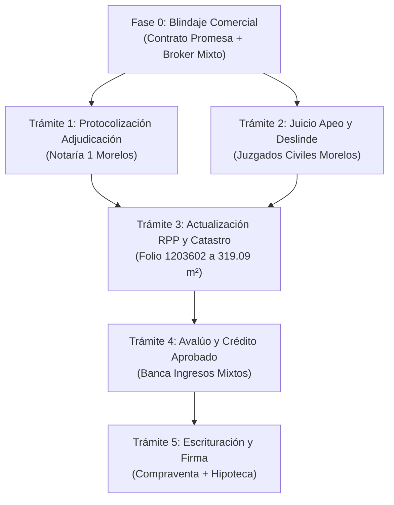

# 🏛️ Plan Maestro y Ruta Crítica: Regularización Registral y Adjudicación ante el RPP
**Proyecto:** Operación Herrera-Caro (Emiliano Zapata No. 215, Col. Francisco Villa, Chihuahua, Chih.)  
**Clave Catastral:** `309-088-007` | **Folio Real RPPyC:** `1203602`  
**Superficie Registral Original:** 302.13 m² | **Superficie Física Real:** 319.09 m² (+16.96 m² / +5.61%)  
**Fecha:** 29 de Octubre de 2026 | **Custodia:** Squad Enrique Marines (Maya, Beto, Clara, Mina)

---

## 👥 1. Convocatoria y Roles del Squad

| Agente | Rol Operativo | Misión Específica en Herrera-Caro |
| :--- | :--- | :--- |
| **Maya** | Master Orchestrator | Custodia del cronograma de ruta crítica, tiempos de juzgado y enlace general. |
| **Beto** | Broker Senior & Notarial Chihuahua | Coordinación de Notaría 1, cabildeo con RPP, perito AMEZ y re-perfilamiento bancario. |
| **Clara** | Diseñadora de Expedientes y Legal | Integración documental del expediente judicial y enlace con abogado patrono. |
| **Mina** | Jefa de Gabinete & Fe Pública | Registro bitácora, custodia de testimonios y seguimiento de hitos de entrega. |

---

## 🧭 2. Diagnóstico del Giro Estratégico

> [!NOTE]
> **Causa del descarte del Plan A:**  
> Los bancos que aceptaban la discrepancia pericial del 5.61% mediante cláusula *Ad Corpus* exigían ingresos 100% formales por nómina timbrada. La compradora (Sra. Herrera) percibe ingresos mixtos (parte nómina y parte actividad económica no formalizada en recibos de sueldo).  
> Los bancos con esquemas de ingresos mixtos (Santander, Banorte, Scotiabank) exigen **simetría matemática absoluta** entre la escritura/RPP y el levantamiento físico para no rechazar la garantía hipotecaria.  
> **Conclusión:** La regularización registral del excedente (+16.96 m²) ante el RPP es el **único camino viable** para destrabar el financiamiento.

---

## 📋 3. Matriz Trámite por Trámite: Documentos, Dependencias y Requisitos

---

### 🔹 Trámite 0: Blindaje Comercial y Convenio Modificatorio
* **Dependencia / Instancia:** Sede Match Home / Notaría Privada.
* **Propósito:** Proteger la exclusividad, asegurar el precio pactado y dar certidumbre a los 4 hermanos Caro y a la Sra. Herrera durante los 4 meses que demore el juzgado.
* **Documentación Requerida:**
  1. Contrato de Promesa de Compraventa con Cláusula de Condición Suspensiva (vigencia 6 meses).
  2. Resguardo de depósito en garantía/enganche en cuenta concentradora o fiduciaria.
  3. Reconocimiento de los 4 herederos aceptando la regularización y la venta final.

---

### 🔹 Trámite 1: Representación Vía Albacea (Adjudicación Pospuesta para Firma Final)
> [!IMPORTANT]
> **Decisión Ratificada (29/Oct/2026):** Se descarta protocolizar la adjudicación por separado ante Notaría 1 en esta etapa para ahorrarle a la familia Caro el doble gasto notarial e ISAI. **Ramiro Caro Nájera comparece directamente como Albacea definitivo** con el Acta Notarial 11086 y 3322 para interponer la Jurisdicción Voluntaria. La protocolización de la adjudicación se fusionará en el instrumento notarial final junto con la compraventa y el crédito hipotecario al obtener la sentencia firme rectificada de 319.09 m².

### 🔹 Trámite 1: Protocolización Notarial de la Adjudicación Sucesoria
* **Dependencia / Instancia:** Notaría Pública No. 1 de Chihuahua (Lic. Manuel Alberto O'Reilly Aguirre).
* **Propósito:** Formalizar que los 4 herederos (Ramiro, Juan Carlos, Linda Mayela y Jaime Horacio Caro Nájera) son los legítimos propietarios en común proindiviso, o dejar preparado el instrumento para fusionar la adjudicación con la rectificación de superficie.
* **Documentación Requerida:**
  1. Acta Notarial 11000 (Radicación Notaría 21).
  2. Acta Notarial 11086 (Declaratoria de Herederos y Nombramiento de Albacea Notaría 21).
  3. Acta Notarial 3322 (Aprobación de Inventario y Avalúo Notaría 1).
  4. Acta Notarial 3330 (Extinción de Patrimonio Familiar Notaría 1).
  5. Boleta Registral RPP con Folio Real `1203602` libre de gravamen.
  6. Identificaciones oficiales (INE), CURP y constancias de situación fiscal de los 4 herederos.
  7. Constancia de no adeudo predial y recibo CUM en ceros.

---

### 🔹 Trámite 2: Juicio de Apeo y Deslinde en Jurisdicción Voluntaria (Mayor Cabida)
* **Dependencia / Instancia:** Juzgado de Primera Instancia de lo Civil del Distrito Morelos (TSJE Chihuahua).
* **Propósito:** Obtener sentencia judicial con fuerza de cosa juzgada que declare que la superficie real legal del predio es de **319.09 m²**, reconociendo los 16.96 m² consolidados intramuros.
* **Fundamento Legal:** Arts. 876 al 888 del Código de Procedimientos Civiles del Estado de Chihuahua.
* **Documentación Requerida:**
  1. **Demanda Inicial:** Promovida por Ramiro Caro Nájera (en su carácter de Albacea de las sucesiones o como copropietario).
  2. **Título de Propiedad Original (1986):** Acredita los 302.13 m² antecedentes.
  3. **Plano Topográfico y Memoria Descriptiva:** Levantamiento elaborado y firmado por el perito topógrafo Ing. José Rodrigo Tamez López (R.P.C. 1499 - AMEZ), con cuadro de construcción UTM y linderos exactos.
  4. **Constancia de Número Oficial:** Emitida por la Dirección de Desarrollo Urbano y Ecología (DDUE) para Zapata 215.
  5. **Cédula de Notificación de Colindantes:** Identificación formal de los 3 vecinos limítrofes:
     - Costado Izquierdo: Predio de la Escuela Antigua (27.89 m - 0 m² de diferencia).
     - Costado Derecho: Lote 217 (habitado/poseedor identificado).
     - Espalda: Lote 216.
  6. **Testigos:** Testimonial de 2 vecinos de la colonia con más de 10 años de arraigo que testifiquen la antigüedad inalterada de las bardas perimetrales.

---

### 🔹 Trámite 3: Actualización Catastral y Rectificación Registral en RPPyC
* **Dependencias:**
  1. Subdirección de Catastro de la Tesorería Municipal de Chihuahua.
  2. Registro Público de la Propiedad y del Notariado (Distrito Morelos).
* **Propósito:** Inscribir la mayor cabida en el Folio Real `1203602` y sincronizar la base catastral.
* **Documentación Requerida:**
  1. Copias certificadas por duplicado del Auto Definitivo y Declaratoria de Firmeza dictada por el Juez Civil.
  2. Oficio judicial girado directamente al Registrador del RPP y al Director de Catastro.
  3. Plano catastral definitivo validado por el Municipio.
  4. Formato de solicitud y pago de derechos registrales de rectificación de asiento.
* **Entregable:** Nueva Boleta Registral que certifique expresamente: **Superficie: 319.09 m²**.

---

### 🔹 Trámite 4: Re-Perfilamiento Crediticio de la Compradora en Paralelo
* **Dependencia / Instancia:** Broker Hipotecario SOC / Entidades Bancarias (Santander / Scotiabank / Banorte).
* **Propósito:** Armar la carpeta hipotecaria de la Sra. Herrera con modelo de comprobación no tradicional mientras se litiga la rectificación, para que el crédito esté aprobado en el momento exacto en que salga la boleta del RPP.
* **Documentación Requerida:**
  1. Recibos de nómina timbrados (ingreso base).
  2. Estados de cuenta bancarios de los últimos 6 meses (demostración de flujo y entradas comerciales adicionales).
  3. Declaración anual/mensual del SAT si aplica, o carta patronal complementaria.
  4. Carta de Autorización de Crédito con cláusula de vigencia renovable a 180 días.

---

### 🔹 Trámite 5: Avalúo Comercial, Notaría y Cierre de Escrituración
* **Dependencia / Instancia:** Notaría seleccionada por el banco acreditante + Unidad de Valuación SHF.
* **Propósito:** Firma simultánea y dispersión de recursos.
* **Flujo Operativo:**
  1. Valuador visita el predio: plano físico (319.09 m²) y RPP (319.09 m²) están en **100% de simetría**. Cero observaciones.
  2. Se emite el avalúo comercial bancario.
  3. Notaría integra certificado de libertad de gravamen (CGL), no adeudos de agua (JMAS), CUM y predial.
  4. **Firma Única:** Adjudicación sucesoria formal + Contrato de Compraventa + Constitución de Hipoteca.

---

## ⏱️ 4. Cronograma de Ruta Crítica (Timeline CPM: 16 Semanas)

| Semana | Hito / Actividad | Responsable | Entregable Clave |
| :---: | :--- | :---: | :--- |
| **Sem 1** | Firma de Convenio Privado de Extensión de Plazo con Vendedores y Compradora. | Beto / Clara | Contrato firmado y resguardo de depósito. |
| **Sem 2** | Integración del expediente judicial, ratificación del Perito Tamez y presentación en Juzgados Civiles Morelos. | Clara / Abogado TSJE | Boleta de ingreso oficial en Oficialía de Partes. |
| **Sem 3–4** | Auto Admisorio del Juez Civil y turno al Actuario para notificaciones. | Abogado Patrono | Notificación formal a los 3 colindantes. |
| **Sem 5–6** | Diligencia de Deslinde en Zapata 215 (Juez/Actuario + Perito AMEZ). | Beto / Perito Tamez | Acta circunstanciada levantada sin oposición. |
| **Sem 7–8** | Vencimiento de plazo de 3 días y emisión de Auto Aprobatorio de Apeo. | Juzgado Morelos | Sentencia firme y oficios sellados. |
| **Sem 9–11** | Ingreso al RPPyC y Subdirección de Catastro Municipal. | Beto / Gestoría RPP | Pago de derechos y turno a registrador. |
| **Sem 12** | Emisión de Boleta Registral Rectificada (319.09 m² en Folio 1203602). | RPP Distrito Morelos | **Boleta en mano.** |
| **Sem 13** | Solicitud y emisión de Avalúo Comercial Bancario con broker. | Broker Hipotecario | Dictamen pericial SHF 100% aprobado. |
| **Sem 14–15** | Integración y dictamen jurídico final en Notaría asignada por el banco. | Notaría / Beto | Proyecto de escritura y cálculo de ISAI/Gastos. |
| **Sem 16** | Firma Notarial Definitiva y Entrega de Posesión a la Compradora. | Enrique Marines / Notario | Escritura firmada y liquidación bancaria a herederos. |
